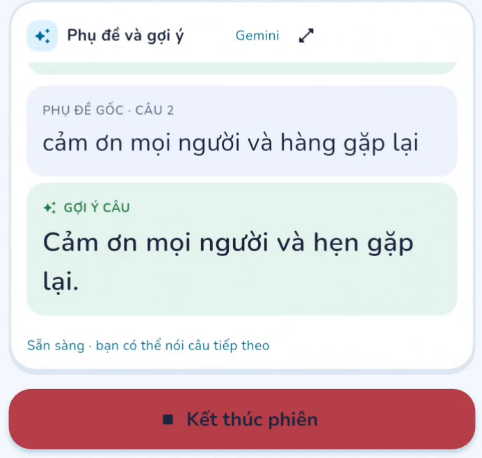

# VietLip

VietLip generates live Vietnamese captions from lip movements. An Android phone streams camera frames over local Wi-Fi to a Windows PC, where the SO17 visual speech model runs on CPU or a compatible NVIDIA GPU. Speech recognition uses the image stream alone.

As the speaker talks, the app shows words that agree across successive video windows. When a segment ends, it saves the original caption. If the user enables sentence suggestions, the PC sends the finalized **text** to Gemini and displays the suggestion underneath. The speaker can continue while the suggestion is pending.



## Do I need a Gemini API key?

**Live captions work without a key.** Gemini is optional and only powers the second line of suggested text.

| How you install VietLip Server | How to enable Gemini suggestions |
| --- | --- |
| **Install the Windows EXE supplied in the private distribution package.** | The supplied installer sets up the included key for a new Windows user profile. Select **Kèm gợi ý câu** (include sentence suggestions) on Android to use it. |
| **Build from this public repository**, including building your own EXE. | Open **VietLip Server → Cài đặt key Gemini** (Gemini API key settings) on the PC, paste your own Gemini API key, and save it. Then select **Kèm gợi ý câu** on Android. |

You can replace a saved key in the same Windows settings. GitHub hosts the source and the SO17 model. The preconfigured EXE is distributed privately.

## Get the source and model

Run the following in PowerShell on Windows:

```powershell
git clone https://github.com/ntthienphuc/Vietlip.git
cd Vietlip
.\tools\get_so17.ps1
```

The script downloads the [SO17 checkpoint](https://github.com/ntthienphuc/Vietlip/releases/download/vietlip-1.10.5-so17/SO_seed17.pt), verifies its SHA-256 digest against the [model manifest](server/models/MODEL_MANIFEST.json), and installs it at `server/models/SO_seed17.pt`. Only the Windows server needs this file. The [1.10.5 model release](https://github.com/ntthienphuc/Vietlip/releases/tag/vietlip-1.10.5-so17) lists its size and checksum for manual downloads.

## Build and run

1. **Build the two applications.** Follow the [Windows and Android build guide](docs/BUILD.md) to produce an APK and a Windows installer. Developers can also run the server directly from the checkout.
2. **Pair the phone and PC.** Connect both devices to the same local network. Open **VietLip Server** on Windows and wait for **Sẵn sàng đọc môi** (ready). On Android, open **Cài đặt → Quét QR máy chủ** (settings → scan server QR). The PC also displays the address for manual entry.
3. **Start captioning.** Tap **Bắt đầu đọc môi** (start lip reading), face the camera, and speak. End the session to review captions in **Lịch sử** (history). The visual model works over the LAN without a cloud account.

## Source layout

| Component | Role |
| --- | --- |
| [Android client](lib) and [CameraX adapter](packages/camera_android_camerax) | Capture camera frames, pair with the PC, render captions, and save sessions. |
| [Inference server](server/README.md) | Load SO17, process the video stream, and return provisional and finalized captions. |
| [Windows launcher](server/desktop_launcher.py) | Show the pairing QR code, report model readiness, and manage the optional Gemini key. |
| [Installer packaging](packaging/windows_server) | Bundle Python, runtime libraries, and the checkpoint into one Windows installer. |

See the [architecture notes](docs/ARCHITECTURE.md) for the streaming pipeline and the [build guide](docs/BUILD.md#verify-the-installation) for an end-to-end check. A [Vietnamese build guide](docs/BUILD_VI.md) is also available.

## Model and third-party assets

Version **1.10.5** ships the Android client (build **30**, `vn.lipread.lip_reader`) and the Windows x64 server. The SO17 model predicts speech from visible movement. Some Vietnamese words have similar mouth shapes, and a fluent suggestion can still change the intended meaning. Session history retains both readings for review.

Upstream components have their own terms. Review the [vendored license notices](server/vendor/licenses), [CameraX license](packages/camera_android_camerax/LICENSE), and [face-alignment asset terms](server/assets/README.md) before redistributing an installer.
